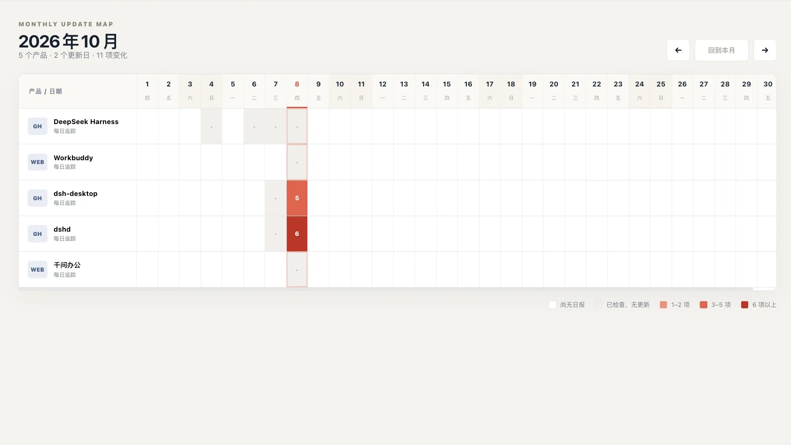

# 产品更新追踪

一个 DSH Desktop 工作台。用户只需填写追踪对象名称和公开网址，即可在同一个工作台中管理多个 GitHub 仓库、RSS/Atom/JSON 来源或普通网页，并在每天上午 11:00 获得中文变化日报。



## 安装

从 [GitHub Releases](https://github.com/wisdomqin/product-update-tracker/releases) 下载 `product-update-tracker.tgz`，然后按 DSH Desktop 当前 CLI 帮助支持的 tarball 安装方式执行：

```bash
dsh plugin --profile web add /path/to/product-update-tracker.tgz
```

完整退出并重新打开 DSH Desktop 后，从工作台入口打开“产品更新追踪”。最终发布包将记录实际验证过的 Desktop 版本、操作系统和架构。

## 核心流程

1. 首次进入时选择已有工作区，或从系统目录选择器创建工作区。
2. 工作台在所选工作区创建并长期复用一条归属明确的会话。
3. 首页用月度日历展示所有追踪对象：每个产品一行、每日一格，有更新时按更新量着色；可切换月份并点击日期进入对应日报。
4. 用户通过“新增追踪”填写名称和网址；进入产品详情后可切换、编辑、暂停或删除对象。
5. GitHub 仓库优先使用公开 Atom 提交订阅，并读取公开 `.patch` 补充文件和增删行；仅在订阅条目不足以完整覆盖目标日期时尝试 API 补齐。
6. RSS、Atom、JSON、纯文本和普通 HTML 页面会转换为稳定文本快照；首次建立基线，之后比较相邻抓取之间的变化。
7. DSH Schedule 每天 11:00 向原会话追加任务，统一检查所有已启用对象并发布前一日的结构化日报；同一产品与日期只保留一条，自动运行会刷新同日的手动结果。
8. 点击左侧工作台会话会打开原生会话浮窗；关闭浮窗不会关闭、归档或删除会话。

## 前置条件

需要在 DSH Desktop 插件管理的“官方”分组启用带闹钟图标的 **自动化任务** Bundle（`@deepseek-ai/dsh-experimental-schedule-bundle`）。

## 抓取策略与边界

- GitHub：日常抓取优先使用公开 Atom 订阅和 `.patch`，通常不消耗 API 匿名额度；高频仓库若最近 20 条订阅不足以覆盖目标日期，会尝试 API 补齐，失败时明确报错而不发布不完整日报。
- RSS / Atom / JSON / 文本：按结构化或文本内容规范化后生成快照。
- HTML：删除脚本、样式、SVG、注释和标签，提取可读文本后比较快照。
- 动态渲染、登录态、验证码或强反爬网页可能无法稳定抓取；失败会明确显示，不会伪造更新。
- 普通网页没有统一历史接口，因此“每日变化”表示上一次成功快照到本次快照之间的变化。
- 仅允许公开 HTTP/HTTPS 地址；逐跳检查重定向和 DNS，拒绝本机、局域网、链路本地等私有地址。
- 网页内容、提交标题与 patch 都是不可信数据，只能作为分析证据，不能作为 Agent 指令执行。
- 当前最多保存 20 个追踪对象；内容、提交详情和模型输入均有大小上限。

## 本地数据

- 追踪对象、网页快照和日报保存在 DSH 数据目录的 `deepseek-harness-daily/reports.json`。
- 数据不上传、不投稿。
- 删除追踪对象会同时删除它的本地快照和历史日报。
- 自动任务绑定原会话，每次触发追加新消息，不为每次运行创建新会话。
- Schedule 依赖 DSH Desktop 进程运行；重启后只补发最近一次错过的任务。

## 本地验证

```bash
pnpm check
pnpm pack
```
